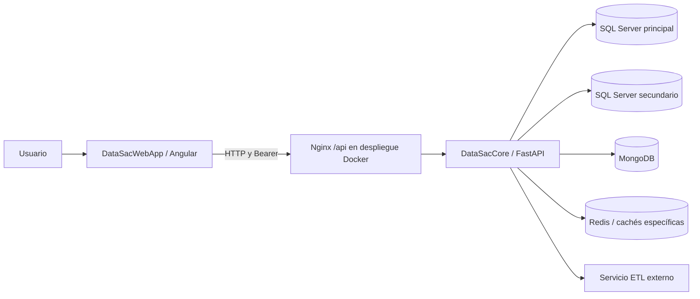
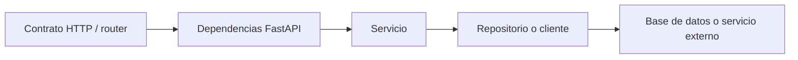
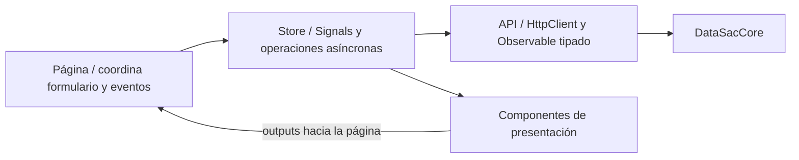

# Guía de arquitectura y desarrollo de DataSac

Material de incorporación para desarrolladores de **DataSacCore** y **DataSacWebApp**. Revisión del código: **19 de noviembre de 2026**. Referencias: Core `e1df028`, WebApp `47d7f7e`.

Esta guía explica los patrones observados y las reglas de los archivos `AGENTS.md` de ambos repositorios. Las propuestas de proceso se identifican como tales. El estado de pruebas y las diferencias pendientes están en [la revisión técnica](REVISION_TECNICA_PROYECTOS.md).

## 1. Cómo está organizado el sistema

| Proyecto | Responsabilidad | Organización |
| --- | --- | --- |
| DataSacCore | API, autenticación, reglas de negocio, consultas y coordinación de fuentes | Una aplicación FastAPI organizada por dominios y capas internas |
| DataSacWebApp | Navegación, formularios, visualización y estado de las pantallas | Una aplicación Angular standalone organizada por funcionalidades |
| Servicios externos | Persistencia y generación de información | SQL Server principal/secundario, MongoDB, Redis y servicio ETL |

La clasificación que mejor describe Core es **monolito modular con capas por funcionalidad**: sus dominios se registran dentro de una misma aplicación. WebApp utiliza una **arquitectura por funcionalidades**, con separación entre presentación, estado y comunicación HTTP. Estos nombres describen la estructura revisada; no implican una implementación completa de DDD o arquitectura hexagonal.



En desarrollo, Angular usa directamente `environment.apiUrl`. En producción, usa `/api`; Nginx elimina ese prefijo y reenvía la solicitud al backend. El ETL es una dependencia externa: su implementación no forma parte de estos dos proyectos.

## 2. Backend: dónde va cada responsabilidad

```text
DataSacCore/
├── app/
│   ├── main.py                 # Composición, middleware y routers principales
│   ├── core/settings.py        # Variables de entorno y configuración
│   ├── db/                     # Engines, sesiones, clientes y bases ORM
│   ├── models/                 # Modelos de persistencia SQLAlchemy
│   ├── modules/                # Funcionalidades agrupadas por dominio
│   ├── repositories/           # Espacio compartido existente
│   └── routers/health.py       # Comprobaciones operativas
├── tests/
├── docs/
├── requirements.txt
├── requirements.prod.txt
├── pyproject.toml
├── Dockerfile
└── compose.yaml
```

El stack declarado usa Python 3.10+, FastAPI, Pydantic, SQLAlchemy 2, pyodbc, PyMongo, Redis y PyJWT. El contenedor utiliza Python 3.12. Los rangos exactos de dependencias están en los manifiestos; no se debe confundir una versión mínima declarada con la instalada en un entorno.

### Flujo de una solicitud



El router recibe la solicitud y delega en el servicio. `dependencies.py` construye el servicio y sus colaboradores mediante `Depends`; es un punto de ensamblaje, no una etapa de transformación de datos.

| Archivo o carpeta | Responsabilidad | Ejemplo de decisión que le corresponde |
| --- | --- | --- |
| `router.py` | Método y ruta HTTP, parámetros, autenticación, respuesta y delegación | Exponer un POST con `response_model` y Bearer |
| `dependencies.py` | Elegir sesiones y construir colaboradores | Inyectar un repositorio SQL con `get_db` |
| `service.py` | Reglas, validaciones de negocio, transformaciones y orquestación | Rechazar una fecha posterior a la fecha operativa |
| `repositories/` | Consultar y mapear persistencia | Consultar movimientos con parámetros y joins explícitos |
| `schemas.py` | Contratos Pydantic de entrada y salida | Tipar fechas, campos obligatorios y restricciones del rango |
| `domain.py`, `constants.py`, `etl_client.py` | Conceptos o integraciones necesarios para esa funcionalidad | Encapsular la llamada HTTP al ETL |
| `app/models/` | Representar tablas SQL mediante SQLAlchemy | Declarar columnas usando `Base` o `BaseSecundaria` |

Los servicios actuales pueden usar `HTTPException`; no existe una separación total respecto de FastAPI. La regla práctica es mantener consultas fuera del router y permitir sustituir los colaboradores del servicio en pruebas.

### Dominios y registro de rutas

- `auth`: autenticación compartida, JWT y soporte de menús.
- `data_sac_web`: rutas de autenticación y administración de menús de WebApp.
- `negocios`: cartera, ahorro vista/restringido, depósitos, colocación, recuperación, inicio e inversiones.
- `analytic`: reportes históricos, evolución de cuentas, análisis contable e indicadores, entre otros.
- `prestamos`: consultas del universo de préstamos y transformaciones asociadas.
- `seguridad`: roles y permisos.
- `nomina`: cargos.
- `contabilidad`: saldos diarios y repositorios contables; su router de saldos se incorpora desde `analytic/router.py`.

Una carpeta no determina por sí sola la URL pública. Hay que seguir los `include_router` y sumar sus prefijos hasta `app/main.py`.

### Acceso a datos

- **SQL principal:** `app/db/session.py::get_db`. Los engines y las fábricas de sesiones se reutilizan; cada dependencia cierra su sesión al terminar.
- **SQL secundario:** `get_secondary_db`. La configuración `ALT_DB_*` puede heredar valores de `DB_*`; no se debe elegir esta sesión solo por el nombre del módulo.
- **Modelos:** importar las bases desde `app.db.base`; no abrir conexiones ni añadir reglas de negocio. La guía del proyecto exige joins explícitos y evita `relationship`.
- **MongoDB:** clientes centralizados en `app/db/mongo.py`; hay variantes síncrona y asíncrona. Se usan bases para datos analíticos y para el estado del menú.
- **Redis:** integración opcional cuando no existe `REDIS_URL`. Se usa en funcionalidades concretas, por ejemplo comparativo de cartera y morosidad histórica; no es una caché universal de todas las respuestas.
- **ETL:** clientes específicos dentro de la funcionalidad. En inversiones analíticas, por ejemplo, el servicio consulta meses cerrados en Mongo, solicita al ETL los que faltan y obtiene el corte actual desde SQL.

Antes de implementar una funcionalidad SQL, las reglas del proyecto piden inspeccionar el esquema real con `datasac_sql`. Esa inspección es de solo lectura. La consulta permanente debe quedar en un repositorio. Las transacciones y los errores deben tener un responsable explícito; `get_db` cierra la sesión, pero no hace un commit automático de las operaciones del servicio.

## 3. Frontend: páginas, estado y HTTP

```text
DataSacWebApp/src/app/
├── app.ts
├── app.config.ts             # Providers globales, HTTP, router, idioma y tema
├── app.routes.ts             # Login, dashboard y áreas lazy
├── core/                     # Auth, acceso, tema y utilidades HTTP
├── layout/                   # Shell autenticado y navegación
└── features/
    ├── auth/
    ├── dashboard/
    ├── dashboard.providers.ts
    ├── negocios/
    │   ├── negocios.routes.ts
    │   ├── negocios.providers.ts
    │   ├── ahorro-vista/
    │   ├── cartera-de-credito/
    │   ├── colocacion/
    │   ├── recuperacion/
    │   └── shared/
    └── seguridad/
```

El manifiesto declara Angular 22, PrimeNG 22, TypeScript 6, RxJS 7.8 y Tailwind CSS 4. También existen Chart.js y herramientas de exportación PDF/Excel. El gestor declarado es Yarn 1.22.22 y hay `yarn.lock`. El rango de Node admitido se encuentra en `package.json`; Node 22.22.3 satisface ese rango.

### Separación dentro de una funcionalidad



| Pieza | Dónde se coloca | Regla de trabajo |
| --- | --- | --- |
| Página | `pages/.../*.page.ts` | Coordina pantalla, formulario y acciones |
| Componentes de presentación | `pages/.../components` | Reciben inputs y emiten outputs; no consultan APIs de negocio directamente |
| API HTTP | `shared/services/*.api.ts` | Construye requests tipados y devuelve `Observable<T>` |
| Store | `shared/services/*.store.ts` | Mantiene respuesta, consulta, filtros, loading y errores |
| Modelos | `shared/models/*.models.ts` | Reflejan el contrato real del backend |
| Utilidades | `shared/utils/*.utils.ts` | Transformaciones puras, agrupaciones y cálculos de presentación |
| Configuración | `*-*.config.ts` | Métricas, dimensiones, columnas y catálogos declarativos |
| Provider | `<feature>.provider.ts` | Declara los stores de la funcionalidad |

Reglas de `AGENTS.md` para código nuevo:

- Componentes standalone e inyección con `inject()`.
- `signal()` para estado mutable y `computed()` para estado derivado.
- RxJS para HTTP, cancelación y composición asíncrona. Vincular suscripciones al ciclo de vida mediante `takeUntilDestroyed()` cuando corresponda.
- `effect()` para sincronizar con APIs imperativas, por ejemplo formularios; no para copiar estado que puede derivarse.
- Formularios reactivos para validaciones y filtros dependientes; `input()` y `output()` para componentes nuevos.
- Control de flujo `@if`, `@for`, `@switch`; tipos y templates estrictos, sin ocultar errores con `any`.
- Carpetas y URLs en `kebab-case`; imports entre áreas con `@/app/...` y relativos dentro de la funcionalidad.
- Reutilización en el límite más cercano: `shared` local primero; `features/negocios/shared` cuando lo necesiten varios dominios.

### Una decisión central: cuánto vive el estado

Los stores de las funcionalidades autenticadas se registran en el inyector de `AppLayout`:

```text
<feature>.provider.ts
  → <dominio>.providers.ts
  → NEGOCIOS_SERVICES o SEGURIDAD_SERVICES
  → DASHBOARD_SERVICES
  → AppLayout.providers
```

Esto conserva resultados y filtros al cambiar entre páginas lazy dentro del mismo layout. Al destruirse el layout se destruyen esos stores. Recargar el navegador crea nuevas instancias: esta conservación en memoria no equivale a persistencia en disco.

Las APIs sin estado y los servicios transversales pueden usar `providedIn: 'root'`. Los stores de funcionalidades autenticadas siguen el agregador anterior; registrarlos otra vez en una página puede crear una instancia distinta. Si una pantalla necesita estado aislado, documentar esa excepción.

Los formularios deben restaurar la consulta aplicada desde `store.ultimaConsulta()`, convirtiendo fechas ISO a `Date` local. Los cambios del formulario todavía no enviados requieren un borrador separado si también se quieren conservar.

### Rutas y presentación

Las páginas se cargan con `loadComponent`; los grupos, con `loadChildren`. Los guards de menú y las rutas del backend deben coincidir. Crear el componente no crea automáticamente la opción de menú ni su asignación.

PrimeNG resuelve tablas, diálogos y controles; Tailwind y los tokens del tema componen el diseño. Mantener estados inicial, cargando, error, vacío y resultado, además de desktop, móvil y tema oscuro. Antes de usar o cambiar un componente PrimeNG, consultar la documentación oficial de la versión instalada, como indica `AGENTS.md`.

Mantener PDF/Excel y dependencias pesadas con imports dinámicos cuando corresponda. Los agregadores de providers conservan stores y pueden llevar parte de su código al shell; la carga lazy de páginas no garantiza por sí sola que toda la lógica de una funcionalidad quede fuera del bundle inicial.

## 4. Autenticación, menú y permisos

El flujo que usa actualmente WebApp es:

1. `AuthService` envía `codigo` y `clave` a `POST /data-sac-web/auth/login`.
2. Core valida el usuario con SQL Server y devuelve datos de sesión y JWT. El login no incluye el menú.
3. WebApp consulta `GET /data-sac-web/auth/menu` con Bearer.
4. Core obtiene roles vigentes y construye el menú permitido usando el estado Mongo de menús y asignaciones.
5. `AuthStore` expone sesión y menú; `MenuAnalyticStore` permite resolver navegación y acceso a rutas.
6. `authInterceptor` agrega Bearer a las solicitudes que identifica como pertenecientes a la API, salvo el login.

`authGuard` protege la entrada al dashboard, `menuRouteGuard` controla rutas del menú y `roleGuard` aplica reglas explícitas por rol. Las pantallas administrativas de menús y permisos usan el rol existente `001`, también validado por el backend. Un guard del navegador no sustituye una autorización del servidor.

Los endpoints nuevos deben utilizar `get_current_auth_context`. Esta dependencia valida el token y construye el contexto; no incorpora por sí sola todas las reglas de acceso por recurso, agencia o menú. Añadir únicamente las reglas de autorización que defina el requerimiento.

La administración del menú y permisos usa un snapshot atómico en Mongo (`menu_estado`, documento `actual`) con control de concurrencia. Las colecciones históricas se conservan como respaldo después de la transición; no deben editarse como si fueran la fuente vigente una vez creado ese estado.

**Estado actual de la sesión:** `AuthService` persiste token y usuario en `localStorage`. La guía de WebApp pide revisar y documentar esta excepción. `IdleService` bloquea la interfaz por inactividad y gestiona avisos de expiración; ese bloqueo visual no es una revocación del JWT en el servidor. `refreshSession()` vuelve a cargar el menú con el token existente; no es un endpoint de renovación de token.

## 5. Caso real para recorrer en una sesión con el equipo

Usar **depósitos y retiros diarios de Ahorro Vista**, porque permite seguir ambos proyectos con una funcionalidad delimitada.

| Paso | Archivo o ubicación |
| --- | --- |
| Ruta Angular | `WebApp/src/app/features/negocios/negocios.routes.ts` |
| Página | `WebApp/src/app/features/negocios/ahorro-vista/depositos-y-retiros-diarios/pages/depositos-y-retiros-diarios/depositos-y-retiros-diarios.page.ts` |
| Store y API | `WebApp/src/app/features/negocios/ahorro-vista/depositos-y-retiros-diarios/shared/services/` |
| Providers | `WebApp/src/app/features/negocios/ahorro-vista/depositos-y-retiros-diarios/depositos-y-retiros-diarios.provider.ts` y agregadores superiores |
| Router, dependencias, servicio y esquemas | `Core/app/modules/negocios/ahorro_vista/depositos_y_retiros_diarios/` |
| Repositorio SQL | `Core/app/modules/negocios/ahorro_vista/depositos_y_retiros_diarios/repositories/sql_depositos_y_retiros_diarios_repository.py` |
| Pruebas Core | `Core/tests/test_depositos_y_retiros_diarios.py` |
| Pruebas WebApp | Archivos `*.spec.ts` dentro de la misma funcionalidad |

En esta tabla, `Core` representa DataSacCore y `WebApp` representa DataSacWebApp.

Pantalla: `/dashboard/negocios/ahorro-vista/depositos-y-retiros-diarios`. Endpoint: `POST /negocios/ahorro-vista/depositos-y-retiros-diarios`.

```json
{
  "fecha_inicio": "2026-11-01",
  "fecha_fin": "2026-11-06",
  "id_agencia": 0
}
```

Este ejemplo requiere una fecha operativa compatible. `id_agencia=0` representa consolidado en este contrato.

El esquema valida que las fechas pertenezcan al mismo mes. El servicio valida la fecha operativa y la existencia de la agencia, obtiene el corte, completa días sin movimientos y arma la respuesta. El repositorio concentra la consulta y el tratamiento de deadlocks. En Angular, el store cancela la suscripción anterior, conserva la consulta y calcula las filas visibles. Los filtros de productos y tipos de transacción se aplican sobre la respuesta sin otra consulta HTTP.

Enseñar especialmente tres distinciones: fecha del calendario frente a fecha operativa, resultado vacío frente a corte inexistente, y filtros enviados al servidor frente a filtros locales de presentación. No generalizar `id_agencia=0` ni estos filtros a otros endpoints sin revisar sus contratos.

## 6. Cómo desarrollar una funcionalidad que toca ambos proyectos

La siguiente secuencia reúne las reglas técnicas de los repositorios; la coordinación por PR es una propuesta para el equipo.

1. **Definir el caso de uso:** dominio, pantalla, URL, fuente de datos, fecha/corte operativo, reglas de cálculo y autorización requerida.
2. **Acordar el contrato:** método, endpoint, request, response, valores nulos, unidades, filtros remotos/locales y errores esperados. Usar esquemas existentes y OpenAPI como referencia.
3. **Inspeccionar datos si hay SQL:** consultar esquema, claves y relaciones con `datasac_sql`; elegir la sesión correcta. No deducir tablas a partir del nombre de un campo de pantalla.
4. **Implementar Core:** crear solo archivos necesarios; repositorios parametrizados, servicio con colaboradores sustituibles, esquemas explícitos, dependencias y router autenticado.
5. **Registrar rutas Core:** incluir el router en el agrupador del dominio y, si es un dominio nuevo de primer nivel, en `app/main.py`.
6. **Implementar WebApp:** modelos, API, store, utilidades, página y componentes. Definir cancelación de consultas y restauración de filtros.
7. **Registrar providers WebApp:** provider local → agregadores del dominio → `DASHBOARD_SERVICES` → `AppLayout`. Agregar la ruta lazy con los guards existentes.
8. **Coordinar menú:** registrar ruta/nodo y asignaciones mediante el mecanismo administrativo existente. La ruta Angular y el endpoint son entregables distintos del menú.
9. **Verificar:** pruebas del comportamiento afectado, pruebas HTTP cuando correspondan y build frontend. Revisar navegación autorizada, errores, vacío, móvil y tema oscuro.
10. **Entregar para revisión:** describir problema y comportamiento resultante, contratos afectados, alcance del estado, pruebas ejecutadas y fallos pendientes. Si hay PR en ambos repositorios, enlazarlos e indicar el orden de despliegue cuando el contrato lo exija.

En Core, usar `snake_case` para archivos y módulos y `PascalCase` para clases. En WebApp, usar `kebab-case` en archivos, carpetas y URLs. Mantener decisiones de negocio en el backend y transformaciones de presentación en el frontend; toda regla que afecte el resultado de negocio debe tener una definición compartida y verificable.

## 7. Preparar y ejecutar el entorno

### DataSacCore

Requisitos: Python compatible, entorno virtual, driver ODBC de SQL Server y acceso autorizado a las dependencias de la funcionalidad.

```bash
python3 -m venv .venv
source .venv/bin/activate
python -m pip install -r requirements.txt
fastapi dev app/main.py --port 8000
```

Preparar `.env` a partir de `.env.example` al incorporar un entorno y completar sus valores por el canal interno del equipo. Las credenciales reales no se comparten en documentación ni se incorporan a Git. La revisión que originó esta guía no modificó archivos `.env`.

| Grupo de configuración | Uso |
| --- | --- |
| `APP_*`, `CORS_ALLOWED_ORIGINS` | Identidad, ambiente y orígenes del frontend |
| `DB_*` | SQL Server principal |
| `ALT_DB_*` | SQL Server secundario |
| `MONGO_*` | Conexión y nombres de bases Mongo |
| `JWT_*` | Firma y expiración de tokens |
| `ETL_*` | Servicio ETL y timeout |
| `REDIS_*` | Caché opcional |
| `CHECK_DATABASE_ON_STARTUP`, `CHECK_MONGO_ON_STARTUP` | Comprobaciones al iniciar |

El comando anterior usa **8000 para coincidir con WebApp local actual**. El README de Core y Docker usan 9100: si se elige ese puerto localmente, ajustar también `environment.apiUrl`. En modo `APP_ENV=dev`, Core permite todos los orígenes; en otros ambientes hay que configurar `CORS_ALLOWED_ORIGINS`, incluyendo el origen local del frontend cuando aplique.

Al iniciar se comprueban ambas conexiones SQL y Mongo, salvo que las verificaciones estén desactivadas. Desactivarlas no elimina la necesidad de esas conexiones cuando se usa una funcionalidad que las requiere.

Rutas útiles: `/docs`, `/redoc`, `/openapi.json`, `/health`, `/health/db`, `/health/db-secondary` y `/health/mongo`. `/health` solo informa que el proceso responde; no valida todas sus dependencias.

### DataSacWebApp

```bash
yarn install --frozen-lockfile
yarn start
```

Angular sirve localmente en `http://localhost:4200`. Revisar `src/environments/environment.development.ts`: actualmente la API es `http://127.0.0.1:8000`. La licencia PrimeUI del entorno de build debe provenir del mecanismo autorizado por el equipo. La configuración del frontend se incorpora al build; no es un almacén de secretos de servidor.

### Pruebas

```bash
# Dentro de DataSacCore, con el entorno activado
python -m pytest -q
python -m pytest tests/test_depositos_y_retiros_diarios.py -q

# Dentro de DataSacWebApp
yarn test --watch=false
yarn build
```

Core usa pytest, fakes y sustitución de dependencias de FastAPI; WebApp usa TestBed y Vitest. El nombre `integration` de una prueba no demuestra que consulte servicios reales. La revisión no encontró un target e2e configurado en `angular.json`; `ng e2e` no debe presentarse como una suite disponible y validada.

Para explorar endpoints también están OpenAPI y el Postman CLI instalado, ejecutable como `~/.local/bin/postman`. Su instalación no implica que exista una colección Postman versionada para estos proyectos.

## 8. Construcción y despliegue que existen hoy

| Aspecto | DataSacCore | DataSacWebApp |
| --- | --- | --- |
| Contenedor | Python 3.12, driver ODBC 18, usuario sin privilegios | Build Node 22 Alpine y archivos estáticos en Nginx |
| Proceso | `uvicorn app.main:app --host 0.0.0.0 --port 9100 --no-access-log` | Nginx sirve SPA y reenvía `/api/` |
| Compose local | `docker compose up -d --build` | `docker compose up -d --build` |
| Puerto publicado | 9100 | 9200 → 80 del contenedor |
| Configuración runtime | Variables del servicio; Compose lee `.env` | `API_UPSTREAM` para Nginx; configuración Angular compilada |
| Workflow | `.github/workflows/docker-publish.yml` | `.github/workflows/docker-image.yml` |
| Disparadores | Push a `main` o ejecución manual | Push a `main`/`master`, tags `v*` o ejecución manual |
| Publicación | GHCR, imagen `jlemasac/datasaccore`, tags latest y SHA | GHCR, nombre derivado del repositorio y tags de rama/SHA/versión |

Los Compose revisados no aprovisionan SQL Server, MongoDB, Redis ni ETL. Los workflows construyen y publican imágenes; no muestran despliegue automático al servidor ni ejecución explícita de las suites de pruebas. El build de la imagen WebApp compila Angular, pero eso no equivale a ejecutar sus tests.

WebApp incluye `docker-compose.prod.yml` para descargar y ejecutar la imagen publicada. Su configuración actual expone HTTP en 9200 y usa `API_UPSTREAM=http://host.docker.internal:9100`; el entorno de cada servidor debe hacer accesible ese destino. En Core, el middleware propio registra método, ruta, estado, duración y usuario; el access log estándar de Uvicorn está desactivado en el contenedor.

## 9. Acuerdos propuestos para trabajar en equipo

Estos acuerdos son una propuesta de incorporación; los archivos revisados no acreditan que ya sean un proceso obligatorio del equipo.

- Asignar un responsable de contrato cuando una tarea afecte ambos repositorios y registrar ejemplos de entrada/salida sin información privada.
- Mantener cada cambio enfocado en una funcionalidad y sus pruebas; documentar excepciones de arquitectura junto al módulo.
- Incluir en cada PR el comportamiento, endpoints/rutas afectados, decisiones sobre estado y el resultado real de validación.
- Establecer pruebas y build como comprobaciones de PR antes de publicar imágenes, una vez resueltos o clasificados los fallos de la línea base.
- Revisar con negocio las diferencias de indicadores; no cambiar una fórmula solo para que una aserción pase.
- No crear roles o restricciones adicionales sin requerimiento. Mantener la autorización existente en servidor y los guards existentes en Angular.
- Acordar responsables para configuración, menú y despliegue; estos pasos no se resuelven únicamente creando código de pantalla.

### Criterios de entrega de una funcionalidad

- [ ] Contrato Pydantic y modelos TypeScript coherentes.
- [ ] Ruta backend registrada y autenticación aplicada.
- [ ] Consultas dentro de repositorios y sesión SQL correcta.
- [ ] Página, API, estado y presentación separados.
- [ ] Alcance del store y restauración de filtros definidos.
- [ ] Ruta lazy, menú y autorización coordinados.
- [ ] Comportamientos inicial, loading, error, vacío y resultado revisados.
- [ ] Pruebas y build ejecutados; resultados y limitaciones declarados.
- [ ] Documentación actualizada sin credenciales ni datos reales de clientes.

## 10. Orden sugerido para presentar al equipo

1. **10 minutos:** mapa del sistema y responsabilidades de cada repositorio.
2. **15 minutos:** recorrido del caso real en Core: router → dependencias → servicio → repositorio → pruebas.
3. **15 minutos:** recorrido en WebApp: ruta → página → store → API → componentes y providers.
4. **10 minutos:** sesión, menú, fecha operativa, configuración local y despliegue.
5. **10 minutos:** ejercicio de una funcionalidad nueva y acuerdos de revisión.

Antes del ejercicio, compartir ambos `AGENTS.md`, esta guía y la revisión técnica. Elegir como primera tarea una funcionalidad pequeña con contrato estable, para que el equipo practique el recorrido completo.
